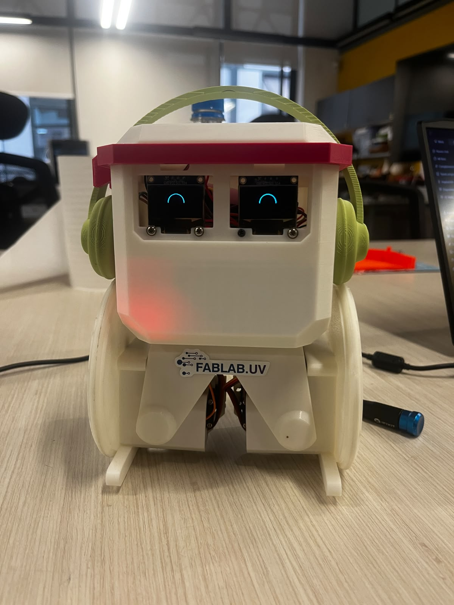
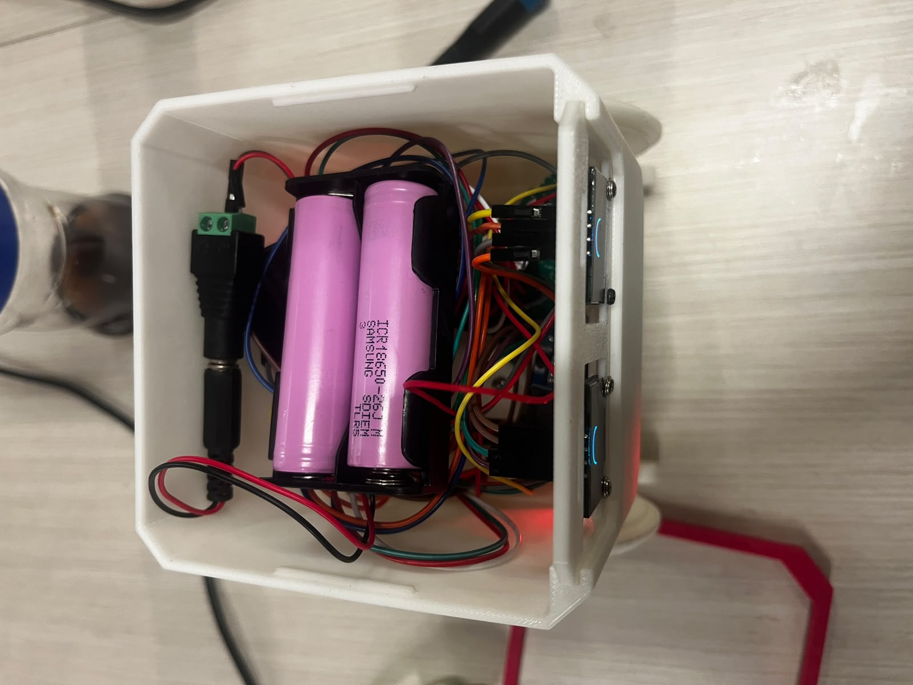

# Otto Ninja XL — FabLab UV
### Adaptación de Hardware Abierto | FabLab UV 🚧 *En desarrollo*

Este repositorio contiene el material técnico para la construcción de un **robot Otto Ninja XL de código abierto**, basado en el proyecto [Otto Ninja XL](https://github.com/boryspimpek/Otto_Ninja_XL) de *boryspimpek* y en el modelo 3D [Otto Ninja XL Remix Version](https://www.printables.com/model/1250758-otto-ninja-xl-remix-version) de Printables, a su vez derivado del [Otto Ninja](https://www.ottodiy.com/) original de OttoDIY. El robot camina, rueda, baila, muestra expresiones en sus ojos OLED y reproduce melodías, todo controlado **desde el celular a través de una página web** servida por el propio robot.

> **Nota:** Este proyecto es una **adaptación del Otto Ninja XL original**. Las diferencias principales respecto a la versión de boryspimpek se detallan en la sección [*Diferencias respecto al diseño original*](#-diferencias-respecto-al-diseño-original).

---

# Objetivo del Proyecto

Desarrollar un robot lúdico y educativo de bajo costo capaz de:

1. **Locomoción híbrida:** Desplazarse rodando sobre sus pies (servos de rotación continua) o caminando (servos de 180° en las piernas), con transición entre ambos modos.
2. **Control inalámbrico sin apps ni controles extra:** El robot crea su propia red WiFi; basta conectar el celular a esa red y abrir el navegador para controlarlo con un joystick táctil.
3. **Expresividad:** Ojos animados en dos pantallas OLED (normal, feliz, sorpresa, corazón) y sonido mediante buzzer con melodías populares.
4. **Fabricación local:** Construir el sistema completo con las impresoras 3D y la electrónica disponible en el FabLab UV.

---

## Vista General del Prototipo

| Vista frontal | Vista lateral |
| :---: | :---: |
|  |  |
| *Ojos OLED duales y carrocería impresa en 3D del modelo Remix.* | *Piernas con servos 180° y pies-rueda con servos 360°.* |

---

# Diferencias respecto al diseño original

Esta versión es una **adaptación** del [Otto Ninja XL de boryspimpek](https://github.com/boryspimpek/Otto_Ninja_XL), con cambios en el control, el sonido y la electrónica según los materiales disponibles en el FabLab UV:

| Característica | Otto Ninja XL original (boryspimpek) | Adaptación FabLab UV |
| --- | --- | --- |
| Método de control | Control **PS4 por Bluetooth** | **Página web** servida por el ESP32 (WiFi propio del robot, joystick táctil desde el celular) |
| Sonido | **DFPlayer Mini** + parlante + tarjeta SD | **Buzzer** en GPIO 25 con melodías generadas por PWM |
| Pantallas | 1 OLED SH1106 | **2 OLED SSD1306 128×64** (un ojo en cada pantalla) |
| Bus de las pantallas | I2C único | **I2C por hardware** (ojo izquierdo, pines 21/22) + **I2C por software** (ojo derecho, pines 16/17) |
| Pinout de servos | 12, 13, 14, 27 | **4, 13, 18, 27** (ver tabla de conexiones) |
| Servos | Servos genéricos | **2× MG996R** (piernas, 180°) + **2× FS5103R** (ruedas, 360°) |
| Alimentación | Fuente genérica | **2× baterías 18650 + LM2596** a 5 V, con condensadores de filtro (470 µF + 2× 220 µF) |
| Firmware | Librerías `PS4Controller` + `DFRobotDFPlayerMini` | Firmware propio con **servidor web embebido**, joystick continuo con watchdog y expresiones aleatorias en reposo |

* El cambio a **control web** elimina la necesidad de un mando PS4: cualquier celular o computador con WiFi puede manejar el robot sin instalar nada.
* El **buzzer** reemplaza al DFPlayer Mini como solución de bajo costo para el sonido; las melodías están programadas nota a nota en el firmware (Mario Bros, Star Wars, Tetris, Coffin Dance, Pantera Rosa y Piratas del Caribe).
* Se agregó un **segundo OLED** para dar un ojo a cada pantalla, con el segundo bus I2C implementado por software al no estar disponible un segundo bus por hardware.

---

# Requisitos del Sistema

## Hardware

* **Microcontrolador:** ESP32 DevKit (ESP32-WROOM-32)
* **Servos de pierna:** 2× servo 180° **MG996R** (piñonería metálica, 4.8–7.2 V)
* **Servos de pie/rueda:** 2× servo de rotación continua 360° **Feetech FS5103R**
* **Pantallas:** 2× OLED SSD1306 128×64 I2C (0.96", alimentadas a 3.3 V desde el ESP32)
* **Sonido:** 1× buzzer pasivo
* **Conversor DC-DC:** 1× step-down **LM2596** con salida ajustada a 5 V
* **Baterías:** 2× Samsung ICR18650 en serie (7.4 V nominal) con portabaterías y conector jack
* **Condensadores de filtro:** 1× electrolítico 470 µF + 2× electrolítico 220 µF en el riel de 5 V
* **Estructura:** Piezas impresas en 3D del modelo [Otto Ninja XL Remix Version](https://www.printables.com/model/1250758-otto-ninja-xl-remix-version) (STL en `HARDWARE/`)
* Cables dupont, tornillería de los servos y cinta/velcro para fijar la electrónica

## Software

* **VS Code + PlatformIO** (recomendado) o **Arduino IDE** 1.8+/2.x con soporte ESP32
* **Librerías Arduino** (se instalan automáticamente con PlatformIO):
  * [ESP32Servo](https://github.com/madhephaestus/ESP32Servo) `^3.2.1`
  * [U8g2](https://github.com/olikraus/u8g2) `^2.36.18`
* **Celular o computador** con WiFi y navegador web para el control

### Interfaz de Control (página web)


*Página web servida por el robot: botón de parada de emergencia, joystick táctil, modos de postura, acciones, expresiones y reproductor de melodías.*


---

### Circuito interior


---
# Conexiones Físicas

> **IMPORTANTE:** realizar todo el cableado con las baterías desconectadas.
> Los 4 servos se alimentan desde la salida de 5 V del **LM2596**, nunca desde el pin 3V3 del ESP32 (ese riel es solo para las pantallas). Toda la electrónica comparte tierra común a través del OUT− del LM2596.

## Tabla de conexiones

### Servos

| Servo | Pin ESP32 | Tipo | Nota |
|---|---|---|---|
| Pierna derecha | D18 | 180° | Posición neutra: 90° (`RNP`) |
| Pierna izquierda | D27 | 180° | Posición neutra: 90° (`LNP`) |
| Rueda derecha | D13 | 360° rotación continua | Freno calibrado: 90° (`RFS`) |
| Rueda izquierda | D4 | 360° rotación continua | Freno calibrado: 87° (`LFS`) |

### Pantallas OLED (ojos)

| Pantalla | Bus | SDA | SCL | Dirección |
|---|---|---|---|---|
| Ojo izquierdo | I2C por hardware | D21 | D22 | 0x3C (típica) |
| Ojo derecho | I2C por software | D16 | D17 | 0x3C (típica) |

* Se usan dos buses I2C porque ambas pantallas comparten la misma dirección de fábrica; la segunda va por software (`U8G2 ... SW_I2C`).

### Buzzer

| Componente | Pin ESP32 | Nota |
|---|---|---|
| Buzzer (+) | D25 | Canal PWM (LEDC) 15 para tonos |
| Buzzer (−) | GND | |

### Alimentación

El robot se alimenta de un pack de **2× baterías Samsung ICR18650 en serie** (7.4 V nominal, 8.4 V a carga completa). El pack entra por un **jack** al conversor step-down **LM2596**, cuya salida de 5 V alimenta los 4 servos y el ESP32:

| Etapa | Conexión |
|---|---|
| Portabaterías (2× 18650 en serie) | Jack → **IN+ / IN−** del LM2596 |
| Salida del LM2596 (**OUT+ / OUT−**) | Riel de **5 V** → positivos y negativos de los 4 servos, y 5V/VIN + GND del ESP32 |
| Pantallas OLED 0.96" | **3V3** y GND del ESP32 |
| Buzzer pasivo | **D25** (señal) y GND del ESP32 |

> **IMPORTANTE:** ajustar el LM2596 **antes** de conectar la electrónica. Medir OUT+ / OUT− con un multímetro y girar el potenciómetro hasta leer **5.0 V**.

#### Condensadores de filtro (riel de 5 V)

Para absorber los picos de corriente de los servos, el riel de 5 V (salida del LM2596) lleva **tres condensadores electrolíticos**: **1× 470 µF + 2× 220 µF**, cada uno conectado entre el positivo y el negativo del riel que alimenta los servos y el ESP32.

* **Ojo con la polaridad:** pata larga (+) al positivo del riel, pata corta (−, lado de la franja) al negativo. Al revés se hinchan y pueden explotar.
* **No** alimentar los servos desde el pin 3V3 del ESP32 (ese es solo para las pantallas).
* Un MG996R trabado puede consumir ~2.5 A; si el robot se reinicia al moverse, revisar la carga de las baterías, el ajuste del LM2596 y la firmeza de las conexiones.

---

## Calibración

Cada servo de rotación continua tiene un punto de **freno** distinto, y los servos de pierna pueden quedar en espejo según el montaje. Todo se ajusta en `src/main.cpp`:

| Constante | Valor actual | Para qué sirve |
|---|---|---|
| `LFS` | 87 | Freno de la rueda izquierda: ajustar hasta que la rueda quede totalmente detenida |
| `RFS` | 90 | Freno de la rueda derecha |
| `LNP` / `RNP` | 90 / 90 | Posición neutra de las piernas (robot de pie y recto) |
| `GAIN_L` | 70 | Compensación de velocidad de la rueda izquierda para que el robot avance derecho |
| `ESPEJO_PIERNA_DER` | true | Si al caminar las piernas "aplauden" en vez de dar pasos, cambiar a `false` |
| `AMP_PASO` | 25 | Amplitud del paso al caminar/hacer moonwalk |

**Procedimiento:** cargar el firmware, abrir el monitor serial (115200 baud) y ajustar primero `LFS`/`RFS` con el robot en el aire hasta que las ruedas no giren en reposo; luego verificar que avance en línea recta y corregir con `GAIN_L`.

---

# Ejecución del Proyecto

## Paso 1 — Cargar el firmware en el ESP32

**Con PlatformIO (recomendado):** abrir la carpeta `firmware/` en VS Code, conectar el ESP32, ajustar `upload_port` en `platformio.ini` al puerto COM correspondiente y presionar *Upload*. Las librerías se instalan automáticamente.

## Paso 2 — Conectarse a la red del robot

Al encenderse, el robot crea su propia red WiFi (el monitor serial muestra la IP asignada):

| Parámetro | Valor |
|---|---|
| Red WiFi (SSID) | `Otto_Ninja_XL` |
| Contraseña | `12345678` |
| Dirección de la página | `http://192.168.4.1` |

## Paso 3 — Controlar el robot

1. En el celular, conectarse a la red WiFi **Otto_Ninja_XL**.
2. Abrir el navegador e ingresar a **http://192.168.4.1**.
3. Usar el **joystick táctil** para mover el robot de forma continua, o los botones para acciones, expresiones y música.

## Controles de la interfaz web

| Control | Acción |
|---|---|
| **PARAR TODO** | Frena las ruedas, detiene la música y vuelve a los ojos normales |
| Joystick táctil | Movimiento continuo (funciona en modo rueda y modo caminar); si se suelta o se pierde la conexión, un watchdog frena el robot |
| **MODO RUEDA** | Postura rodante: las piernas se inclinan para apoyar las ruedas |
| **MODO CAMINAR** | Postura erguida para caminar |
| **CAMINAR** | Secuencia de 3 pasos hacia adelante |
| **MOONWALK** | Caminata hacia atrás estilo moonwalk |
| **FELIZ / SORPRESA / CORAZON** | Expresiones de los ojos OLED (el corazón late) |
| **MARIO / STAR WARS / TETRIS / COFFIN DANCE / PANTERA ROSA / PIRATAS** | Reproduce la melodía por el buzzer |
| **SILENCIAR MUSICA** | Detiene la melodía actual |

*En reposo, el robot parpadea y muestra expresiones aleatorias cada ciertos segundos.*

---

# Estructura del Repositorio

```text
otto-ninja-xl/
│
├── HARDWARE/                  # Piezas 3D (STL del modelo Remix de Printables)
├── firmware/
│   ├── platformio.ini         # Proyecto PlatformIO (ESP32 DevKit)
│   └── src/main.cpp           # Servidor web, control de servos, ojos OLED y buzzer
├── docs/
│   ├── BOM.md                 # Lista de materiales y costos
│   └── diagrama_conexiones.png
└── README.md
```

---

# Flujo del Sistema

```text
Celular (navegador web)
        │  WiFi AP "Otto_Ninja_XL"
        ▼
ESP32 (servidor web en :80)
        │
        ├── GPIO 4, 13, 18, 27 ──► 4 servos (ruedas 360° + piernas 180°)
        ├── I2C 21/22 + I2C soft 16/17 ──► 2 OLED SSD1306 (ojos)
        └── GPIO 25 (PWM) ──► Buzzer (melodías y efectos)
```

1. El usuario abre la página web del robot desde el celular conectado a su WiFi.
2. El navegador envía comandos HTTP al ESP32 (joystick cada 80 ms, botones por ruta).
3. El ESP32 traduce los comandos a movimiento de servos con interpolación suave.
4. Un watchdog frena el robot si dejan de llegar comandos del joystick (>650 ms).
5. Las pantallas OLED muestran los ojos y el buzzer acompaña con sonido.

---

# Tecnologías Utilizadas

* ESP32 + Arduino Framework + PlatformIO
* Servidor web embebido (WebServer) + HTML/JS con joystick táctil
* ESP32Servo (control PWM de servos)
* U8g2 (pantallas OLED SSD1306, I2C hardware y software)
* Impresión 3D FDM
* Fabricación digital

---

# Aplicaciones Potenciales

* Educación STEM y talleres de robótica
* Docencia en programación de sistemas embebidos y redes
* Prototipado de robots de entretenimiento de bajo costo
* Difusión del FabLab y la robótica open source

---

# Referencias

* **Proyecto base:** [boryspimpek/Otto_Ninja_XL](https://github.com/boryspimpek/Otto_Ninja_XL) — *Otto Ninja XL ESP32 PS4 Robot Controller*
* **Modelo 3D:** [Otto Ninja XL Remix Version](https://www.printables.com/model/1250758-otto-ninja-xl-remix-version) — Printables
* **Diseño original:** [Otto Ninja](https://www.ottodiy.com/) — OttoDIY y Sebastian Coddington
* **Licencia del diseño original:** Creative Commons Attribution-ShareAlike 4.0 (CC-BY-SA) — las adaptaciones deben mantener la misma licencia y dar crédito a los autores originales

---

# Créditos

Adaptación desarrollada por **[Maria-Ignacia Rojas](https://github.com/MariaIgnaciaR)**, estudiante de pregrado de Ingeniería Civil Biomédica, generación 2021. Ayudante de FabLab UV.

